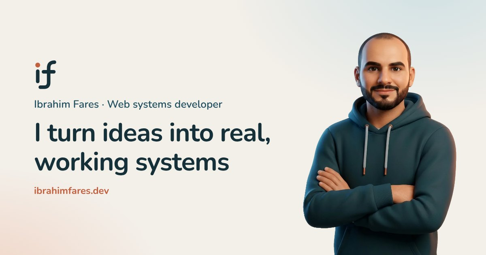
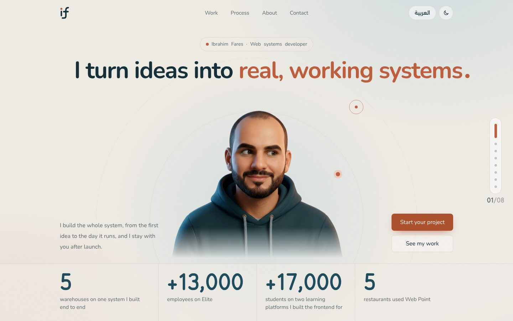
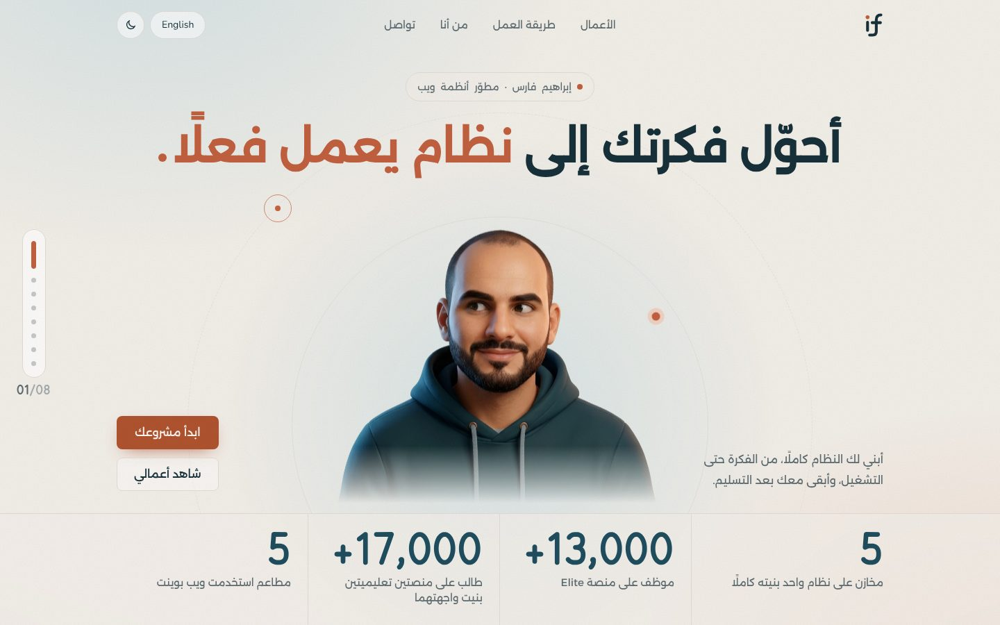
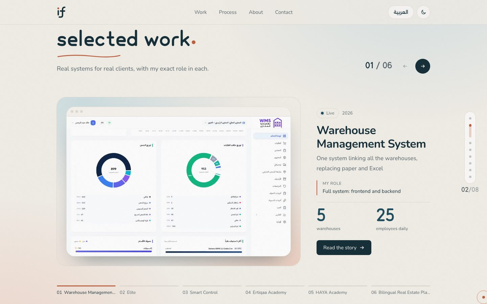
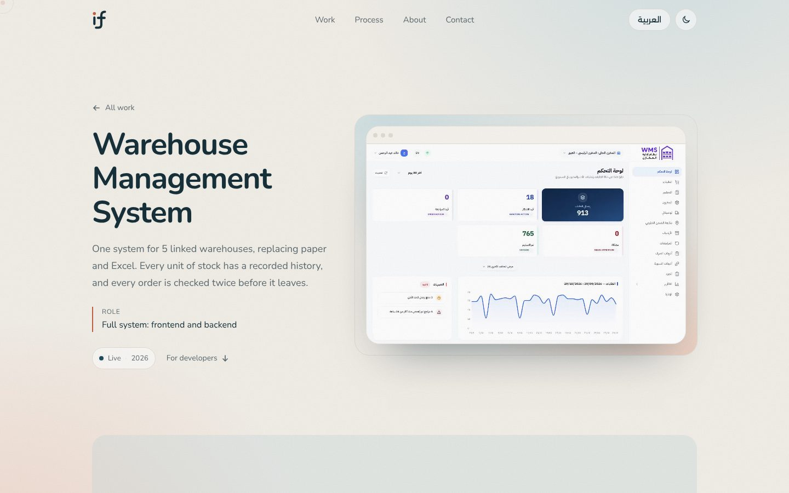
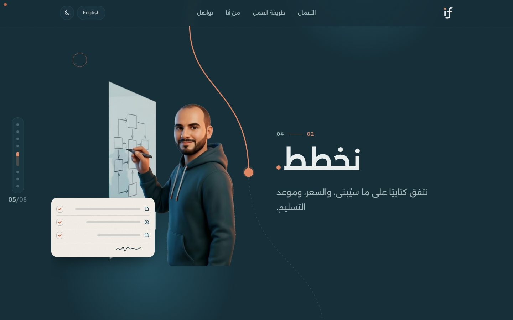
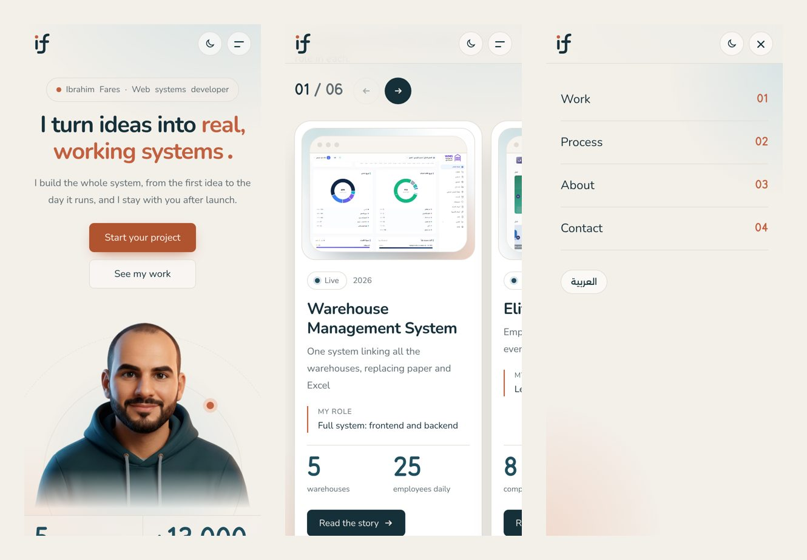

<div align="center">

<a href="https://ibrahimfares.dev"></a>

# ibrahimfares.dev

**The portfolio of Ibrahim Fares, web systems developer.**
Real systems for real clients, told with the numbers behind them, in Arabic and English.

[**Visit the site →**](https://ibrahimfares.dev) &nbsp;·&nbsp; [العربية](https://ibrahimfares.dev/ar) &nbsp;·&nbsp; [English](https://ibrahimfares.dev/en)


</div>

---

## What this is

A bilingual (RTL / LTR), light and dark, motion-led portfolio built from scratch: no template, no UI kit.
It presents seven production systems through a horizontal project showcase and a full case study for each one,
written for two readers at once: a founder who wants to know *what it does and who uses it*, and an engineer who
wants to know *how it is built*.

| | |
| --- | --- |
| **5** warehouses on one system I built end to end | **+13,000** employees on Elite |
| **+17,000** students on two learning platforms I built the frontend for | **5** restaurants used Web Point |

<p align="center">
  
  
</p>

## The work it presents

| Project | What it is | Role | Status |
| --- | --- | --- | --- |
| **Warehouse Management System** | One system linking every warehouse, replacing paper and Excel | Full system: frontend and backend | Live |
| **Elite** | Employee benefits platform: offers, events, points and gifts | Lead frontend developer | Live |
| **Smart Control** | Elite's dashboard: companies, partners, gifts and reports | Lead frontend developer | Live |
| **Ertiqaa Academy** | Arabic-learning platform for UAE schools | Lead frontend developer | Live |
| **HAYA Academy** | Interactive lessons, auto-marked homework and a certificate per skill | Lead frontend developer | Live |
| **Real estate platform** | A marketplace from listing to signed contract and payment | Lead frontend developer | Delivered |
| **Web Point** | Restaurant POS and back office | Co-founder, lead frontend developer | Delivered (2022) |

Each case study covers the problem before the system, what was built, key features, my exact role, real results,
screen recordings, desktop and mobile screens, and a technical section with the architecture diagram.

<p align="center">
  
  
</p>

## Highlights

**A living portrait.** The hero character is a face on a WebGL sheet: the eyes follow the cursor, he blinks,
reacts to hovering, taps and pulls, and plays little scenes when the page goes quiet. The skin is a damped wave
simulation on a 73 × 73 grid that sleeps when settled, skips frames that would look the same, and runs at half
rate with a lighter canvas on phones.

**One brand motion everywhere.** The `if` mark is written by a pen in the preloader, and every page change is a
circle that grows from the click point, writes the mark, and opens on the new page. The engine is inlined in
`<head>`, so it runs before any bundle loads.

**Built for Arabic first.** True RTL layouts, Arabic typography (Alexandria), Western digits everywhere, and a
word-by-word text reveal that keeps English names in order inside Arabic sentences.

**Section-by-section reading on desktop, natural scrolling on phones.** Wheel, keys and trackpad move one band
at a time, long sections scroll internally first, and the header takes the tone of the band beneath it.

**Measured, not guessed.** On a simulated mid-range phone, a performance pass took the page from 7.1 s to 3.9 s
before it uncovers, and idle main-thread load from saturated to about a third.

**Privacy-friendly analytics.** Self-hosted Umami with no cookies; contact clicks, project opens and how far
people read are tracked by one site-wide listener that leaves the page transitions untouched.

<p align="center">
  
  
</p>

## Tech stack

| Area | Tools |
| --- | --- |
| Framework | Next.js 16 (App Router, standalone output), React 19, TypeScript |
| Styling | Tailwind CSS 4, design tokens for the brand palette, light and dark themes |
| Motion | GSAP (Observer, ScrollTo), a hand-written WebGL portrait, an inline motion engine |
| i18n | next-intl, `/ar` and `/en` with alternates, RTL / LTR |
| Content | Typed `project.json` packages and Markdown case studies, validated with Zod at sync time |
| Media | AVIF / WebP screens, H.264 + WebM loops, generated with sharp and ffmpeg |
| SEO | Per-page metadata, sitemap, robots, JSON-LD (Person, WebSite, CreativeWork), branded social cards |
| Ops | Docker, nginx, Let's Encrypt on a VPS, self-hosted Umami analytics |

## Project structure

```
src/
  app/[locale]/            pages: home, /projects/[slug], 404 (+ sitemap, robots, manifest)
  components/
    sections/              home sections: Hero, Projects, OtherWork, WhatICanBuild, HowWeWork, Tools, About, Contact
    case/                  case-study parts: video theatre, screen viewers, next project
    hero/                  the living portrait (WebGL)
    layout/                header, footer, section pager, cursor, page transitions
    analytics/             click and section events
  lib/                     motion engine, project data, tracking
content/projects/          one folder per project (generated by `npm run sync`)
messages/                  all site copy, ar.json and en.json
public/                    avatar, project media, social images, CV
scripts/                   project sync, social image rendering
```

## Run it locally

```bash
npm install
npm run dev            # http://localhost:3000 → /ar
npm run build && npm start
```

Requires Node 22 (`.nvmrc`). No environment variables are needed; `NEXT_PUBLIC_SITE_URL` is only for a staging host.

## Deploy

The site runs in its own container behind nginx:

```bash
git pull
docker compose up -d --build          # serves on 127.0.0.1:3005
```

nginx terminates HTTPS and forwards the domain to `127.0.0.1:3005`, passing the original host
(`proxy_set_header Host $host;` and `X-Forwarded-Proto $scheme`). Security headers and media caching are set in
`next.config.ts`.

<details>
<summary><b>Maintenance notes</b></summary>

- **Project content.** `npm run sync` copies each package from `../projects` (project.json and case studies) and
  optimises covers, loops and posters into `public/projects/`. The generated files are committed, so a fresh
  clone builds without the packages.
- **Copy.** All text lives in `messages/`. Arabic is simple Modern Standard Arabic; numbers always use Western
  digits. Wrap numbers like `+13,000` in `className="num"` so the sign stays in place in Arabic.
- **Social images.** `python3 scripts/og/render.py http://localhost:3100` renders the home cards (2400 × 1260);
  `scripts/og/render-projects.py` renders one card per case study. Both need a build running on that port and
  Python Playwright.
- **Events.** Add `data-track="name"` (and `data-track-*` properties) to any button to count its clicks, or pass
  `track` to a `<Band>` to count how many visitors reach it.

</details>

## Contact

**Ibrahim Fares** · Web systems developer · Egypt, working remotely

[ibrahimfares.dev](https://ibrahimfares.dev) · [WhatsApp](https://wa.me/201007218535) · [ibrahimfares511@gmail.com](mailto:ibrahimfares511@gmail.com) · [LinkedIn](https://www.linkedin.com/in/ibrahimfares511) · [GitHub](https://github.com/ibrahimfares511)

---

<sub>© 2026 Ibrahim Fares. All rights reserved. The code is public to read and learn from; the design, the brand,
the avatar and portrait, and the project content and media are not licensed for reuse.</sub>
